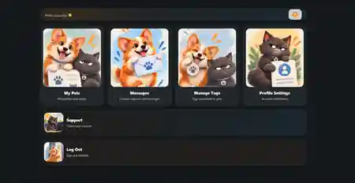

# Mohammad Hossein Moradi — Portfolio

Static portfolio website prepared for GitHub Pages.

## Before publishing

Edit `index.html` and replace:

- Add your LinkedIn URL when the profile is ready.
- Add your GitHub profile URL after creating the account.

## Add screenshots

Project screenshots are already included in `/assets`. Add one mobile Shenasnapet screenshot later if available.

- `shenasnapet-dashboard.webp`
- `shenasnapet-profile.webp`
- `shenasnapet-mobile.webp`
- `hoviateman.webp`

Then replace the placeholder `.shot` blocks in `index.html` with `` tags. Example:

```html

```

## Publish on GitHub Pages

1. Create a repository named `YOURUSERNAME.github.io`
2. Upload all files from this folder to the repository root
3. Open repository **Settings → Pages**
4. Under **Build and deployment**, choose **Deploy from a branch**
5. Select `main` and `/ (root)`
6. Your portfolio will be available at `https://YOURUSERNAME.github.io`

## Optional custom domain

You can later connect your own domain in **Settings → Pages → Custom domain**.

## Positioning used in this portfolio

Primary:
- PHP / WordPress Backend Developer
- WordPress Plugin Developer

Secondary:
- API / Integration Developer
- Product-oriented WordPress Developer

The portfolio intentionally presents Dadeh Kavan Andisheh Bartar accurately as technical support + UI implementation rather than software development.


## Current contact details

- Email: `moradi.mh93@gmail.com`
- GitHub profile: `https://github.com/mhmoradi93`
- LinkedIn: add later when profile is ready
